# Learning Library 📚✨

> *Simpan rasa ingin tahumu sebelum hilang.*

**Project UTS Pemrograman Mobile** — aplikasi Flutter **Personal Learning Library**: tempat
mengumpulkan, mengelola, dan mengeksplorasi segala sesuatu yang ingin dipelajari — buku, artikel,
video, course, game edukatif, podcast, atau paper riset.

| | |
|---|---|
| **Nama** | I Kadek Very Andika |
| **NIM** | 2415051065 |
| **Kelas** | 5 IKI |
| **Tema** | Personal Learning Library |
| **Branch utama** | `main` |

<p>
  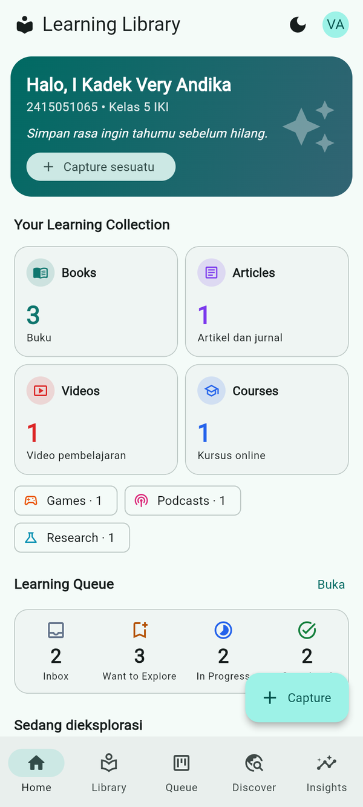
  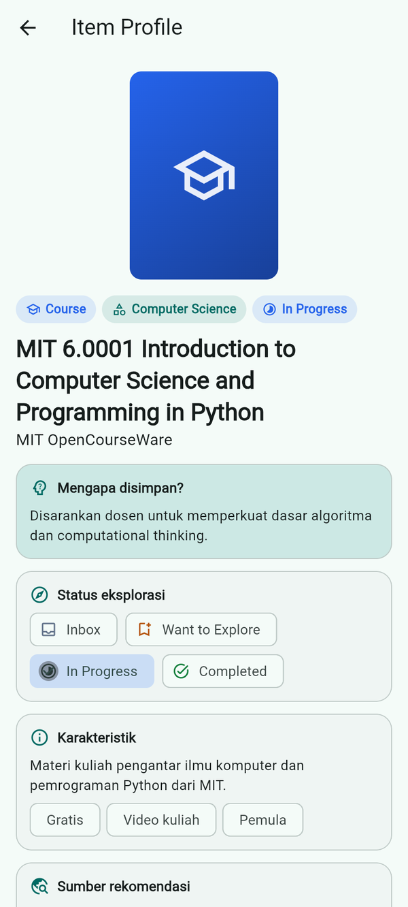
  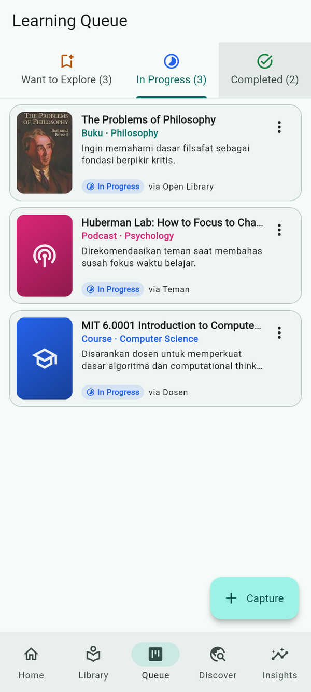
  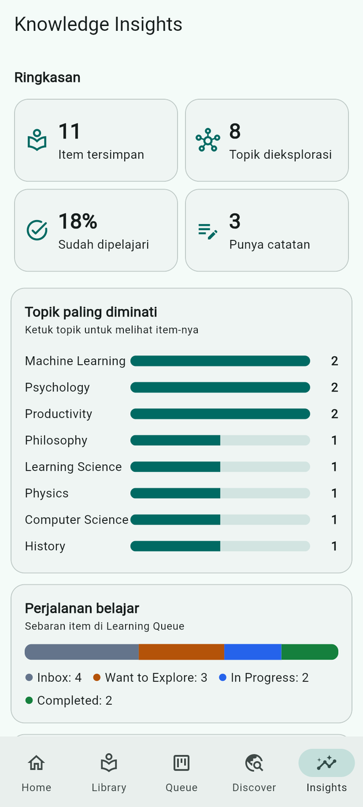
</p>

## Masalah yang diselesaikan

Saat scrolling TikTok atau menonton YouTube, kita sering menemukan buku, video kuliah, atau
artikel yang menarik. Biasanya judulnya disimpan, lalu beberapa hari kemudian **lupa** — bahkan
lupa *mengapa* dulu tertarik. Learning Library mengubah setiap temuan menjadi **Learning Item**
yang menyimpan bukan hanya judul dan link, tetapi juga:

| Wishlist biasa | Learning Library |
|---|---|
| Judul | Judul, pembuat, dan **karakteristik** |
| Link | Link dan **sumber rekomendasi** (TikTok, YouTube, teman, dosen, …) |
| Favorit | **Alasan mengapa tertarik** (wajib diisi) |
| Kategori | **Jenis media** *dan* **topik pengetahuan** (dua hal berbeda) |
| Status dibaca | **Status eksplorasi**: Inbox → Want to Explore → In Progress → Completed |
| Catatan sederhana | **Learning notes**: ide utama, pertanyaan, refleksi + rating |

## Fitur

| Bagian | Fitur |
|---|---|
| **Home** — *Your Learning Collection* | Jumlah item per jenis media (Books, Articles, Videos, Courses, …), ringkasan Learning Queue, item yang sedang dieksplorasi, *recently collected* |
| **Capture** (Create) | Form tambah item: 8 jenis media, judul, pembuat, link (validasi `http/https`), topik + saran topik, sumber rekomendasi, alasan disimpan, deskripsi, karakteristik, status, catatan, rating |
| **Library** (Read) | Cari (judul/topik/sumber/alasan), filter jenis media, topik, dan status, urutkan, pull-to-refresh, list ↔ grid responsif |
| **Item Profile** | Alasan disimpan, status eksplorasi (ganti langsung), karakteristik, sumber + salin link, learning notes, **ringkasan topik dari Wikipedia** |
| **Edit** (Update) | Ubah seluruh profil item, status, catatan, rating |
| **Hapus** (Delete) | Dari Item Profile atau geser di Queue — selalu dengan **dialog konfirmasi** |
| **Learning Queue** | Tab per status (HP) / papan kanban 4 kolom (desktop), pindah status lewat menu |
| **Discover** | Cari buku di **Open Library** → simpan ke Library dengan form yang sudah terisi otomatis |
| **Insights** — *Knowledge Overview* | Topik paling diminati (ketuk → Library terfilter), jenis media, perjalanan belajar, sumber rekomendasi |
| **Profil** | Nama, NIM, kelas, **dark mode** |

Semua operasi penting memberi **SnackBar**; setiap layar data punya **loading / empty / error state**
dengan tombol *Coba lagi*. Error jaringan, timeout, HTTP 404/429/5xx, JSON tidak sesuai, dan error
PostgreSQL (23505, 23514, 42501) diterjemahkan menjadi pesan yang mudah dipahami.

## Tech stack

| Kebutuhan | Teknologi |
|---|---|
| Framework | Flutter 3.47 (Dart 3.13), Material 3 |
| State management | `provider` (ChangeNotifier) |
| REST API client | `http` |
| Backend database | `supabase_flutter` (Supabase / PostgreSQL + RLS) |
| Testing | `flutter_test`, `http/testing` (MockClient) |

## REST API yang digunakan

| API | Endpoint | Dipakai untuk |
|---|---|---|
| **Open Library** (tanpa key) | `GET https://openlibrary.org/search.json?q=...` | Discover: pencarian buku & chip topik |
| | `GET https://openlibrary.org/works/{id}.json` | Deskripsi & subjek buku |
| | `GET https://covers.openlibrary.org/b/id/{id}-M.jpg` | Cover buku |
| **Wikipedia REST** (tanpa key) | `GET https://{id,en}.wikipedia.org/api/rest_v1/page/summary/{topik}` | Ringkasan topik di Item Profile |

Response JSON diubah menjadi model `Book` dan `TopicSummary` (null-safe).

## Backend / database yang digunakan

**Supabase (PostgreSQL)** — `https://uzzntuknqcazlcugmkrl.supabase.co`, tabel **`learning_items`**
(primary key + 17 kolom). SQL lengkap: [`docs/supabase_schema.sql`](docs/supabase_schema.sql).

| Kolom | Keterangan |
|---|---|
| `id` | bigint identity, **primary key** |
| `title` | judul (tidak boleh kosong) |
| `media_type` | `CHECK in (book, article, video, course, game, podcast, research, other)` |
| `topic` | bidang pengetahuan, mis. *Psychology* |
| `creator`, `url`, `cover_url` | pembuat, link, gambar |
| `source` | asal rekomendasi (TikTok, YouTube, Teman, …) |
| `description`, `characteristics` | profil item; karakteristik dipisah koma |
| `reason` | **mengapa disimpan** |
| `status` | `CHECK in (inbox, want, progress, done)` |
| `notes`, `rating` | learning notes; rating `CHECK 1–5` |
| `external_key` | key Open Library (jika dari Discover) |
| `student_id`, `created_at`, `updated_at` | pemilik & waktu |

RLS **aktif**; policy permisif untuk role `anon` hanya untuk praktikum (belum ada login).
Aplikasi hanya memakai **publishable key**.

## Arsitektur

Prinsip: **UI → Provider → Repository → Service / Data Source → REST API / Database**.
Screen tidak pernah memanggil HTTP atau query database secara langsung.

```
CAPTURE ──► LEARNING ITEM ──► LIBRARY ──► QUEUE ──► NOTES ──► INSIGHTS
(TikTok, YouTube, Discover, manual)

lib/
├── config/        # AppConfig, AppTheme (teal), SupabaseConfig (publishable key)
├── models/        # LearningItem, MediaType, ItemStatus, Book, TopicSummary
├── services/      # SupabaseLearningItemService (CRUD), OpenLibraryService, TopicService (Wikipedia),
│                  # data source abstrak + InMemory (test), AppException
├── repositories/  # LearningItemRepository, BookRepository, TopicRepository (cache)
├── providers/     # LibraryProvider (shared state: data, filter, ringkasan),
│                  # BookProvider (Discover), TopicProvider, ThemeProvider
├── screens/       # home_shell, home, library, queue, discover, discover_detail, capture,
│                  # edit_item, item_profile, insights, profile
├── widgets/       # LearningItemForm, ItemCard/ItemGrid, ItemThumb, Pill, BookCard, BookCover,
│                  # RatingInput/RatingStars, ResponsiveGrid/MaxWidth, SectionHeader,
│                  # LoadingView/ErrorView/EmptyView, showConfirmDialog
└── main.dart      # Supabase.initialize + MultiProvider (data source dipilih di satu tempat)
```

- **Shared state**: `LibraryProvider` dipakai Home, Library, Queue, Discover (status "Di Library"),
  Item Profile, dan Insights — perubahan di satu layar langsung terlihat di layar lain.
- **Responsive**: compact < 600 (NavigationBar + FAB Capture), medium 600–1023 (NavigationRail
  berlabel), expanded ≥ 1024 (NavigationRail extended). Grid Library 1→2→3 kolom, Queue tab →
  kanban, Insights 1 → 2 kolom, Item Profile kolom → baris.

## Screenshot

| Home | Library | Item Profile | Topik (Wikipedia) |
|---|---|---|---|
|  | 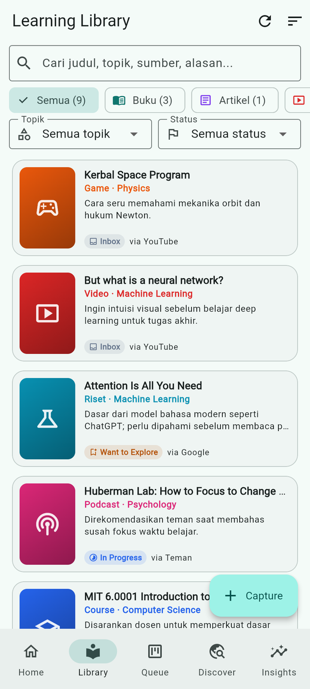 |  | 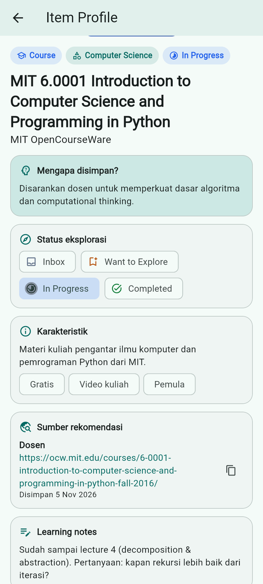 |

| Capture (Create) | Validasi form | Learning Queue | Pindah status |
|---|---|---|---|
| 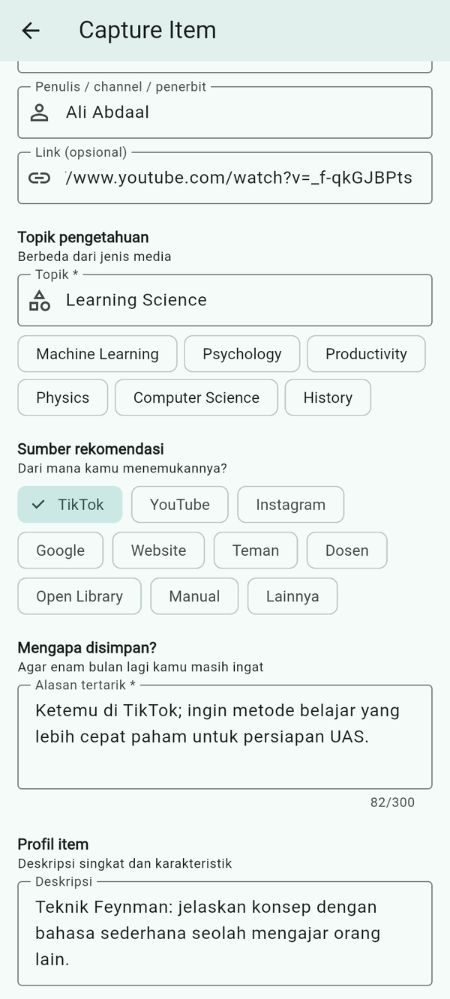 | 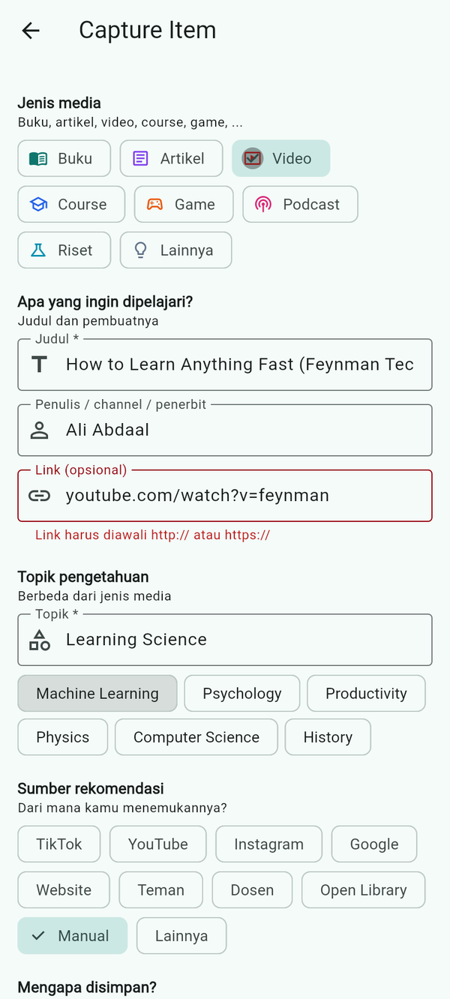 | 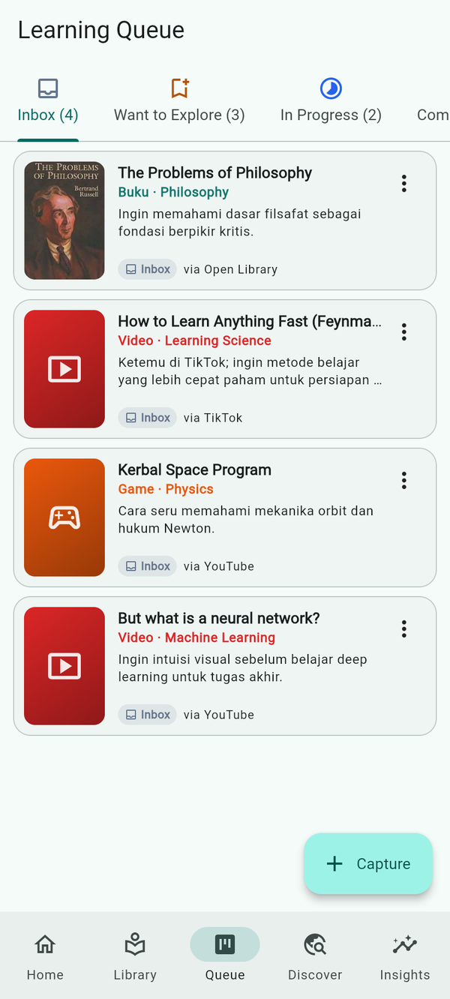 | 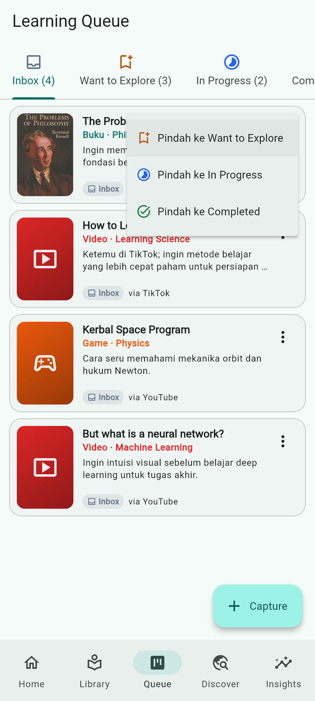 |

| Edit (Update) | Hapus (Delete) | Discover (API) | Simpan dari Discover |
|---|---|---|---|
| 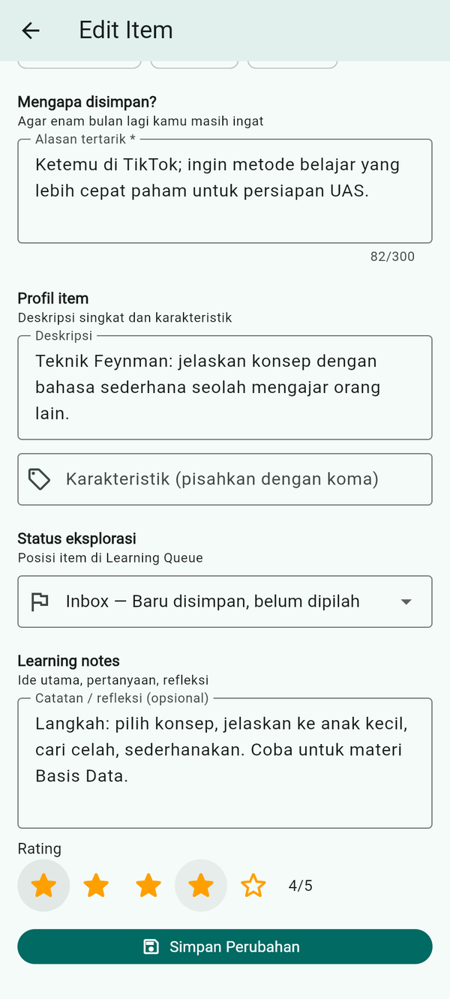 | 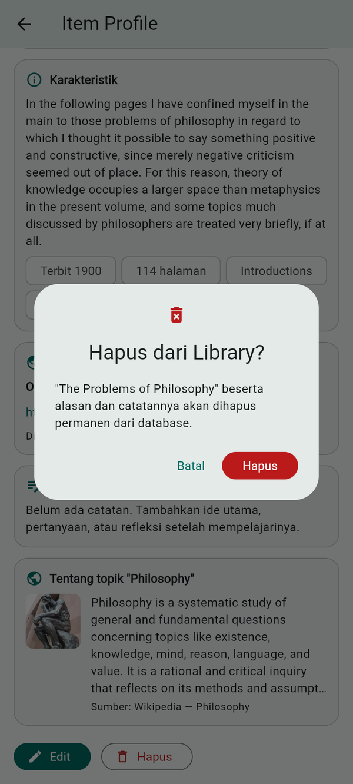 | 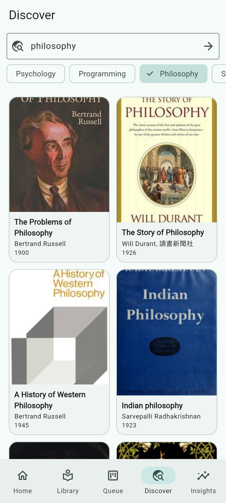 | 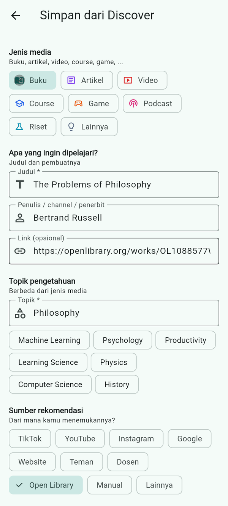 |

| Insights | Dark mode | Empty state | Error (offline) |
|---|---|---|---|
|  | 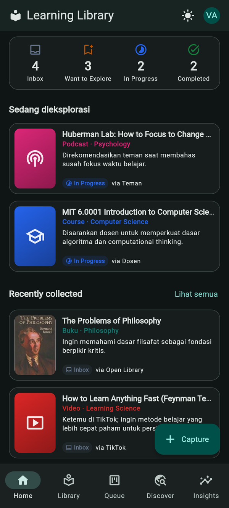 | 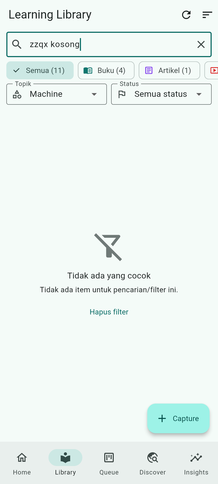 | 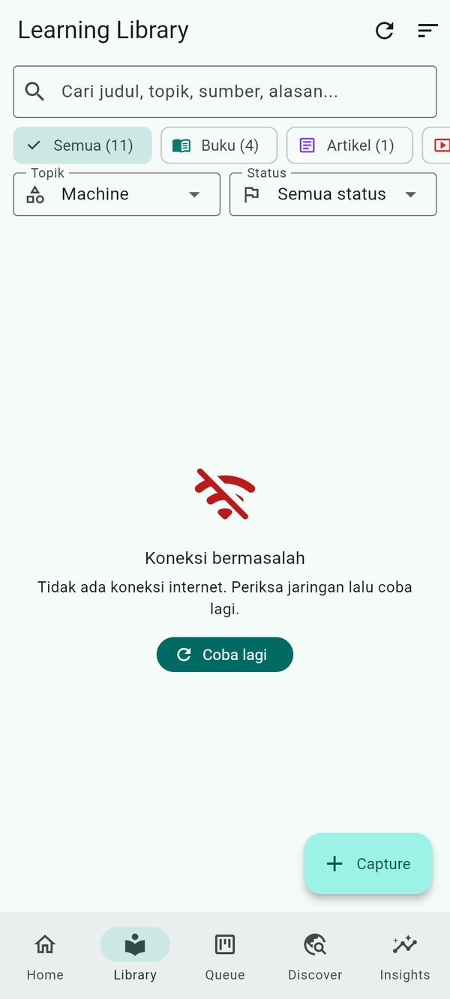 |

**Layar lebar (NavigationRail):**

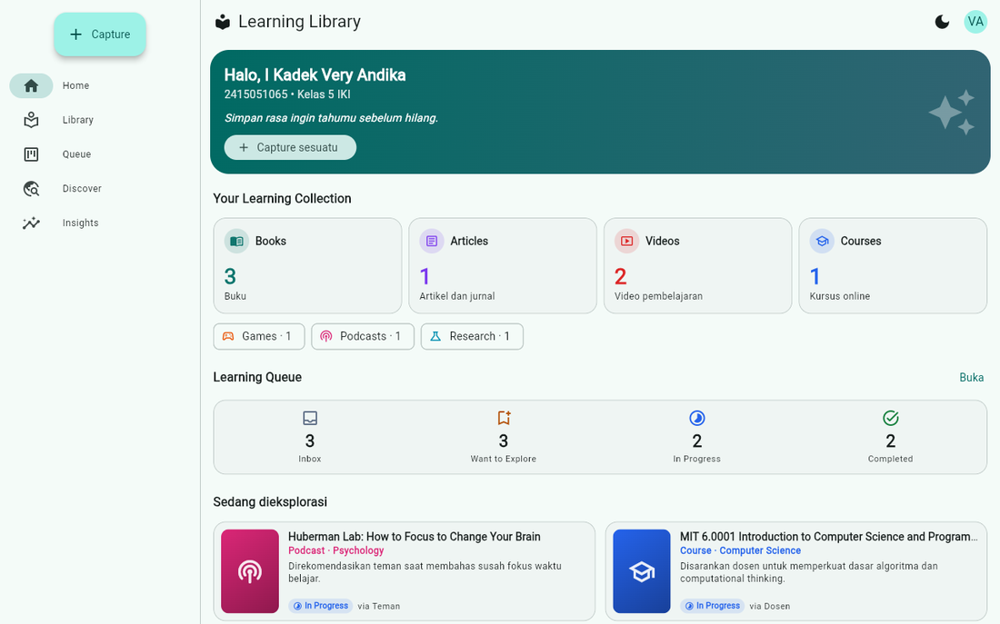
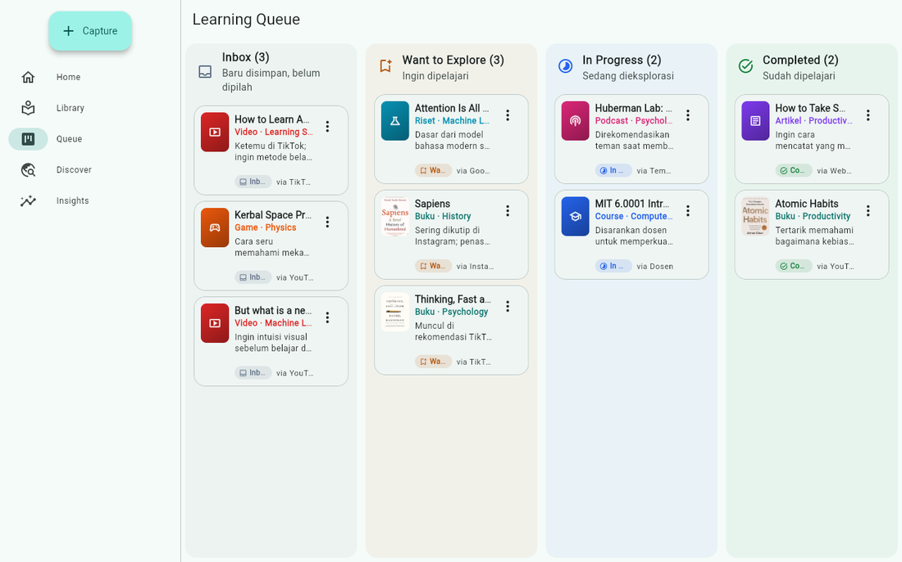
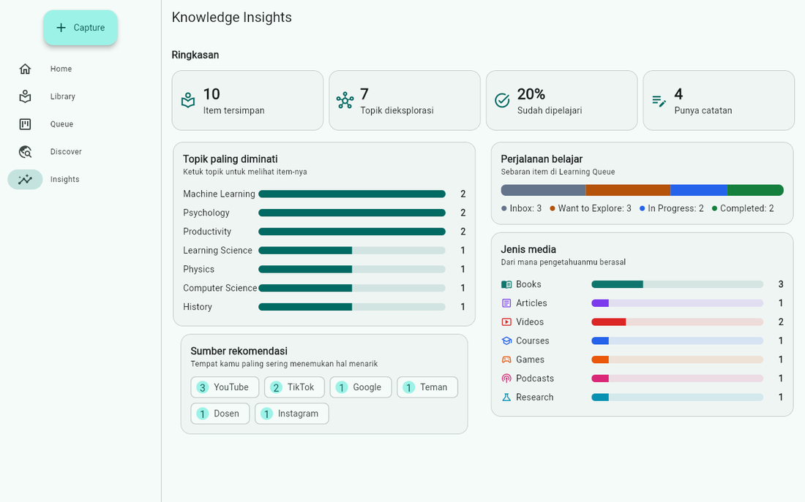

**Data di Supabase:**

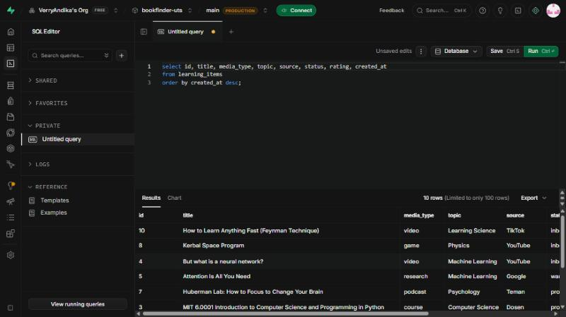

Semua screenshot: [`docs/screenshots`](docs/screenshots). Data contoh di screenshot adalah item
belajar milik pengembang, sebagian dibuat langsung lewat aplikasi (Capture & Discover).

## Cara menjalankan

```bash
git clone https://github.com/VerryAndika/UTS_2415051065_I_Kadek_Very_Andika.git
cd UTS_2415051065_I_Kadek_Very_Andika
flutter pub get
flutter run                 # emulator / HP Android
flutter run -d chrome       # atau di browser
flutter test                # unit test
flutter build apk --release # build APK
```

Untuk memakai project Supabase sendiri: jalankan `docs/supabase_schema.sql` di SQL Editor,
lalu ganti `url` dan `publishableKey` di `lib/config/supabase_config.dart`.

**APK**: [Releases](https://github.com/VerryAndika/UTS_2415051065_I_Kadek_Very_Andika/releases) —
`v2.0.0` (Learning Library). `v1.0.0` adalah versi awal BookFinder.

## Riwayat pengembangan

Aplikasi dikembangkan bertahap. **v1 (BookFinder)** — 16 milestone sesuai panduan UTS:

| # | Milestone | # | Milestone |
|---|---|---|---|
| 1 | Initialize Flutter UTS project | 9 | Integrate backend database |
| 2 | Setup project architecture and folders | 10 | Implement create data feature |
| 3 | Build initial application UI | 11 | Implement update data feature |
| 4 | Implement responsive layouts | 12 | Implement delete data feature |
| 5 | Add application navigation | 13 | Add interaction and user feedback |
| 6 | Add application data models | 14 | Add loading and error handling |
| 7 | Implement application state management | 15 | Improve UI and responsive behavior |
| 8 | Integrate REST API | 16 | Finalize UTS mobile application |

**v2 (Learning Library)** — konsep diperluas dari aplikasi buku menjadi Personal Learning Library:

| # | Commit |
|---|---|
| 17 | Evolve data layer into Learning Library |
| 18 | Add capture form and item profile |
| 19 | Build library, queue and discover screens |
| 20 | Add knowledge insights and new home for Learning Library |
| 21 | Finalize Learning Library v2.0.0 (README, screenshot, polish) |

Lihat `git log --oneline` untuk riwayat lengkap.

## Keamanan

- Hanya **publishable key** Supabase di aplikasi; **tidak ada** `service_role`/secret key,
  password database, token, atau keystore di repository.
- `.env`, `*.jks`, `*.keystore`, `key.properties` diabaikan lewat `.gitignore`.
- Validasi form hanya membantu pengguna; aturan data tetap ditegakkan database (`CHECK`, RLS).

## Rencana pengembangan

Ambil metadata otomatis dari link, rangkuman AI, rekomendasi materi, peta pengetahuan antar topik,
dan login pengguna (RLS per akun).
