# BookFinder 📚

**Project UTS Pemrograman Mobile** — aplikasi Flutter untuk **mencari buku** dari REST API
Open Library dan **mengelola koleksi bacaan pribadi** (status baca, rating, catatan, progress
halaman) yang tersimpan di database **Supabase (PostgreSQL)**.

| | |
|---|---|
| **Nama** | I Kadek Very Andika |
| **NIM** | 2415051065 |
| **Kelas** | 5 IKI |
| **Tema** | BookFinder (katalog buku + koleksi bacaan) |
| **Branch utama** | `main` |

<p>
  
  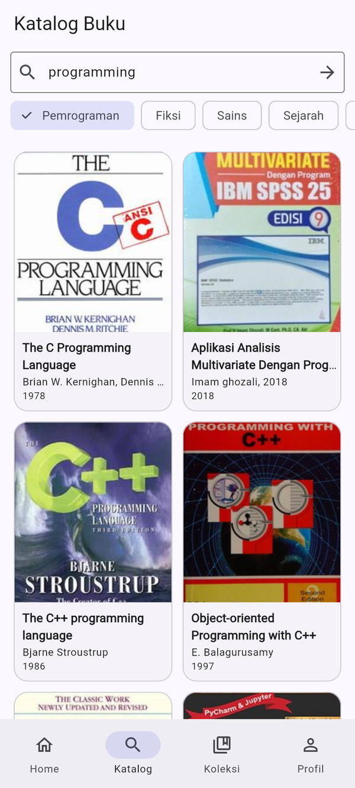
  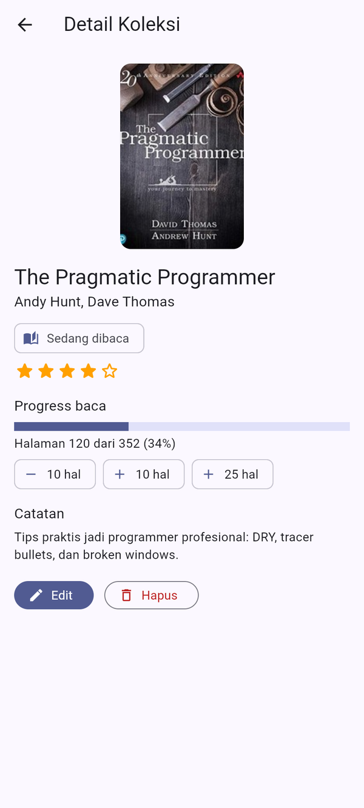
  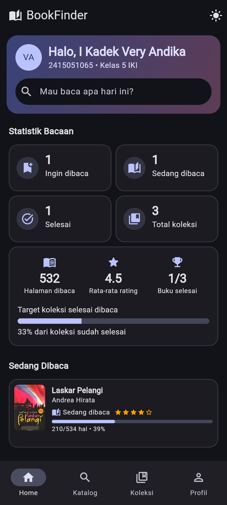
</p>

## Konsep integrasi

- **REST API (Open Library)** → katalog buku publik: pencarian, rekomendasi, detail (deskripsi & subjek).
- **Database (Supabase)** → data personal pengguna: buku yang disimpan, status baca, rating,
  catatan, dan halaman terakhir. API dan database memiliki fungsi yang berbeda.

```
Home ──► Katalog (cari / kategori) ──► Detail Buku ──► Tambah ke Koleksi (INSERT)
                                                           │
Koleksi (filter/urut) ◄────────────────────────────────────┘
   └─► Detail Koleksi ──► Edit (UPDATE) / +halaman (UPDATE) / Hapus + konfirmasi (DELETE)
```

## Fitur

- **8 screen fungsional**: Home/Dashboard, Katalog (list/grid), Detail Buku, Tambah ke Koleksi
  (Create), Edit Koleksi (Update), Koleksi Saya, Detail Koleksi, Profil.
- **Navigasi utama** `NavigationBar` (HP) / `NavigationRail` (tablet & desktop), navigasi
  list → detail dengan **passing data** (`Book` / `id` lewat constructor).
- **Pencarian** judul/penulis + **chip kategori** (Pemrograman, Fiksi, Sains, Sejarah, Bisnis, Indonesia).
- **CRUD database** `saved_books`: tambah, baca, ubah, hapus (dengan **dialog konfirmasi**,
  dari tombol Hapus maupun swipe).
- **Form + validasi**: status (SegmentedButton), rating bintang (FormField), halaman terakhir ≤ total
  halaman, angka valid, rating wajib bila status *Selesai*, catatan minimal 3 karakter.
- **Loading / empty / error state** dengan tombol **Coba lagi**, pesan error ramah untuk jaringan,
  timeout, HTTP 404/429/5xx, JSON tidak sesuai, dan error PostgreSQL (23505, 23514, 42501).
- **Feedback**: SnackBar untuk setiap operasi penting, AlertDialog, pull-to-refresh, tombol muat ulang.
- **Fitur tambahan (kreativitas)**:
  - 📊 **Statistik bacaan** — jumlah per status, halaman dibaca, rata-rata rating, persentase selesai.
  - 📖 **Progress halaman** — progress bar + tombol cepat −10 / +10 / +25 halaman.
  - 🔎 **Filter & urutkan koleksi** — per status; urut terbaru, judul, rating, progress.
  - 🌙 **Dark mode** — tombol di Home dan switch di Profil.
- **Responsive**: 3 kondisi layout (compact < 600, medium 600–1023, expanded ≥ 1024);
  grid katalog berubah jumlah kolom (`LayoutBuilder`), statistik 2 ↔ 4 kolom, rekomendasi
  list horizontal ↔ grid, koleksi list ↔ grid 2–3 kolom, detail kolom ↔ baris.

## Tech stack

| Kebutuhan | Teknologi |
|---|---|
| Framework | Flutter 3.47 (Dart 3.13), Material 3 |
| State management | `provider` (ChangeNotifier) |
| REST API client | `http` |
| Backend database | `supabase_flutter` (Supabase / PostgreSQL + RLS) |
| Testing | `flutter_test`, `http/testing` (MockClient) |

## REST API yang digunakan

**Open Library API** — `https://openlibrary.org` (publik, tanpa API key)

| Method | Endpoint | Dipakai untuk |
|---|---|---|
| GET | `/search.json?q={query}&limit=24&fields=key,title,author_name,first_publish_year,cover_i,number_of_pages_median,subject` | Katalog, pencarian, kategori, rekomendasi |
| GET | `/works/{id}.json` | Deskripsi & subjek di Detail Buku |
| GET | `https://covers.openlibrary.org/b/id/{cover_i}-M.jpg` | Gambar cover |

Response JSON diubah menjadi model `Book` (`Book.fromJson`, null-safe).

## Backend / database yang digunakan

**Supabase (PostgreSQL)** — project `bookfinder-uts` (`https://uzzntuknqcazlcugmkrl.supabase.co`).
SQL lengkap: [`docs/supabase_schema.sql`](docs/supabase_schema.sql).

Tabel `public.saved_books` (primary key + 12 kolom):

| Kolom | Tipe | Aturan |
|---|---|---|
| `id` | bigint identity | **Primary key** |
| `student_id` | text | default `2415051065` |
| `book_key` | text | key work Open Library; `UNIQUE(student_id, book_key)` |
| `title`, `author` | text | judul tidak boleh kosong |
| `cover_url` | text | URL cover |
| `status` | text | `CHECK in ('want','reading','done')` |
| `rating` | int | `CHECK 1–5` |
| `note` | text | catatan / review |
| `current_page`, `total_pages` | int | `current_page ≥ 0`, `total_pages > 0`, `current_page ≤ total_pages` |
| `created_at`, `updated_at` | timestamptz | default `now()` |

RLS **aktif**; policy permisif untuk role `anon` hanya untuk keperluan praktikum (belum ada login).

## Arsitektur

Prinsip: **UI → Provider → Repository → Service / Data Source → REST API / Database**.
Screen tidak pernah memanggil HTTP atau query database secara langsung.

```
lib/
├── config/          # AppConfig (identitas, base URL), AppTheme, SupabaseConfig (publishable key)
├── models/          # Book, SavedBook, ReadingStatus, sample_books
├── services/        # BookDataSource ← OpenLibraryService (http)
│                    # SavedBookDataSource ← SupabaseSavedBookService (supabase_flutter)
│                    # AppException (penerjemah error)
├── repositories/    # BookRepository, SavedBookRepository
├── providers/       # BookProvider, CollectionProvider (shared state), ThemeProvider
├── screens/         # home_shell, home, catalog, book_detail, add_book, edit_book,
│                    # collection, saved_book_detail, profile
├── widgets/         # BookCard, BookCover, StatCard, SectionHeader, ResponsiveGrid, MaxWidth,
│                    # SavedBookForm, RatingInput/RatingStars, SavedBookTile, ReadingStatsCard,
│                    # LoadingView/ErrorView/EmptyView, showConfirmDialog
└── main.dart        # Supabase.initialize + MultiProvider (pemilihan data source di satu tempat)
```

- **Model** (`models/`): representasi data + konversi JSON, tanpa Flutter widget.
- **Service** (`services/`): detail akses data (HTTP, Supabase), timeout, dan konversi error.
- **Repository** (`repositories/`): satu pintu data untuk provider; sumber data bisa diganti
  (mis. `SampleBookService` / `InMemorySavedBookService`) tanpa mengubah UI.
- **Provider** (`providers/`): state `loading / data / error`, filter, urutan, statistik.
  `CollectionProvider` adalah **shared state** yang dipakai Home, Katalog, Detail, dan Koleksi.
- **Screen & widget**: hanya membaca state (`context.watch`) dan memanggil aksi provider.

## Screenshot

| Home | Katalog (API) | Detail Buku | Tambah (Create) |
|---|---|---|---|
|  |  |  | 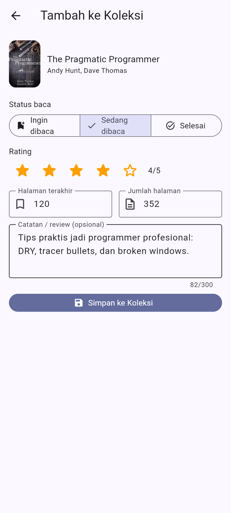 |

| Validasi form | Koleksi (database) | Detail Koleksi | Edit (Update) |
|---|---|---|---|
| 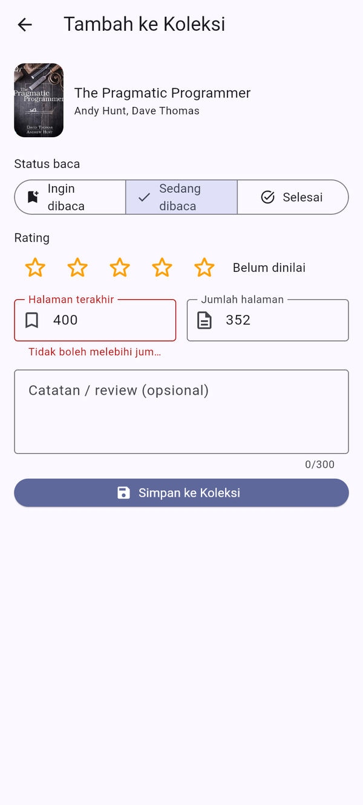 | 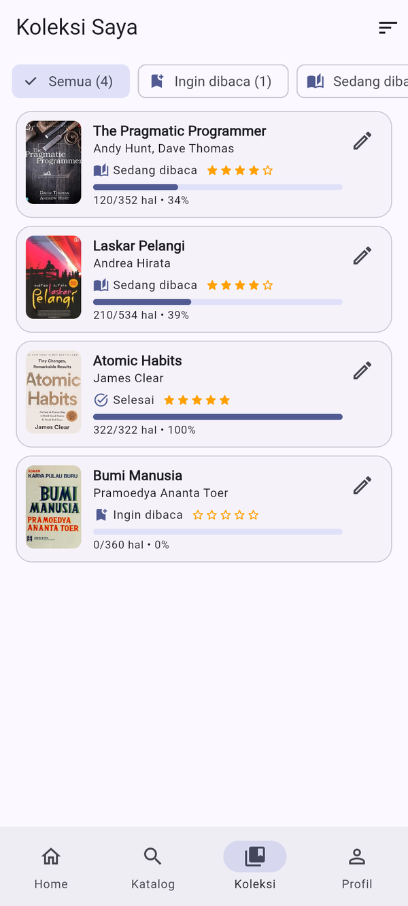 |  | 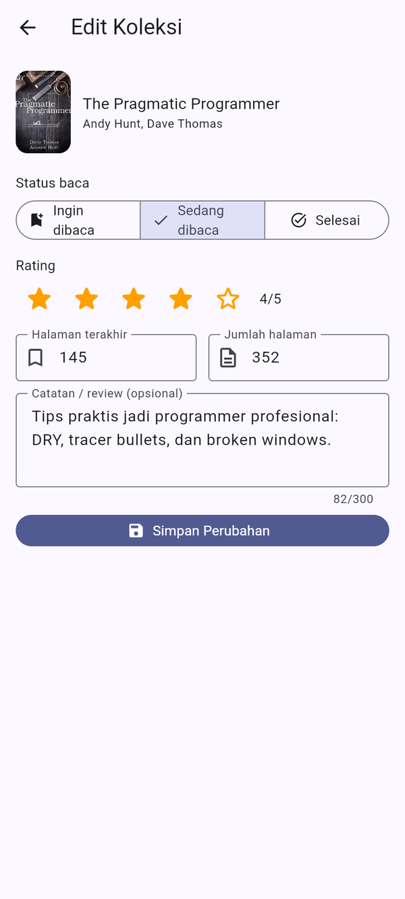 |

| Konfirmasi hapus (Delete) | Filter status | Empty state | Error (offline) |
|---|---|---|---|
| 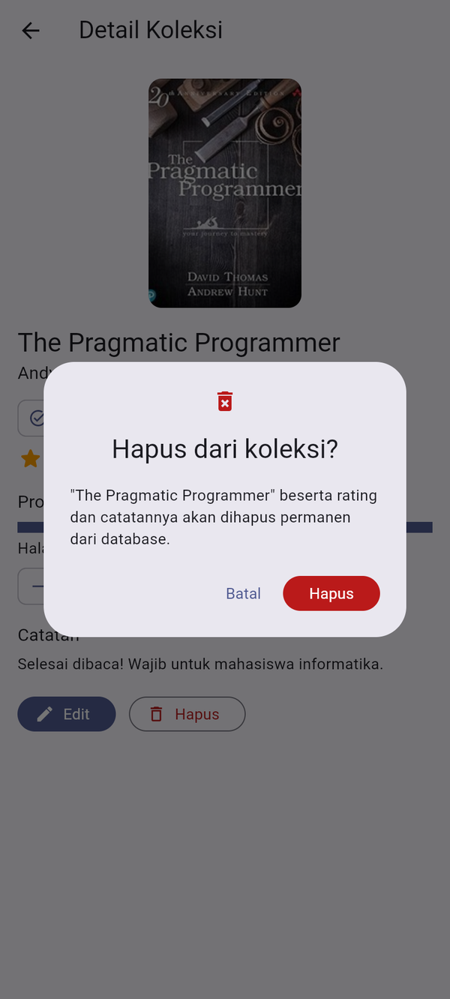 | 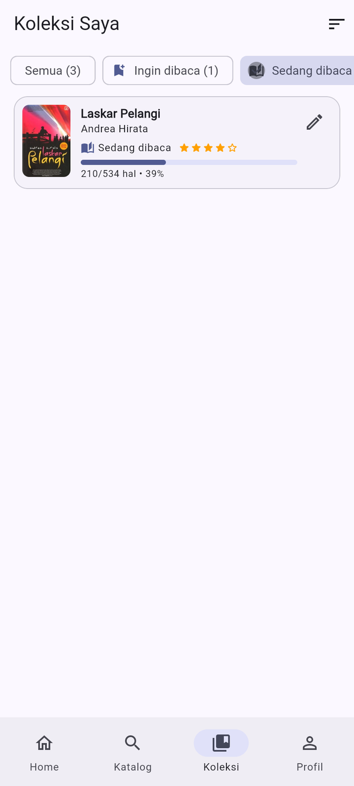 | 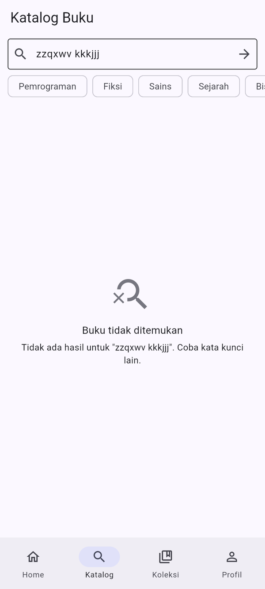 | 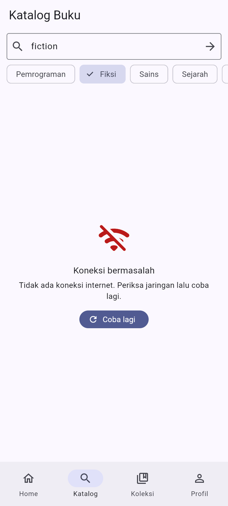 |

| Loading state | Profil | Dark mode | Error database |
|---|---|---|---|
| 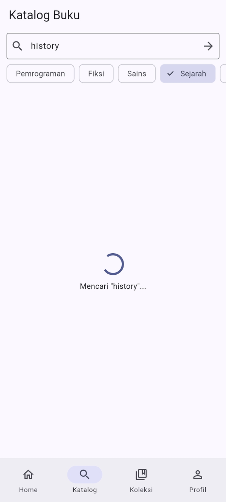 | 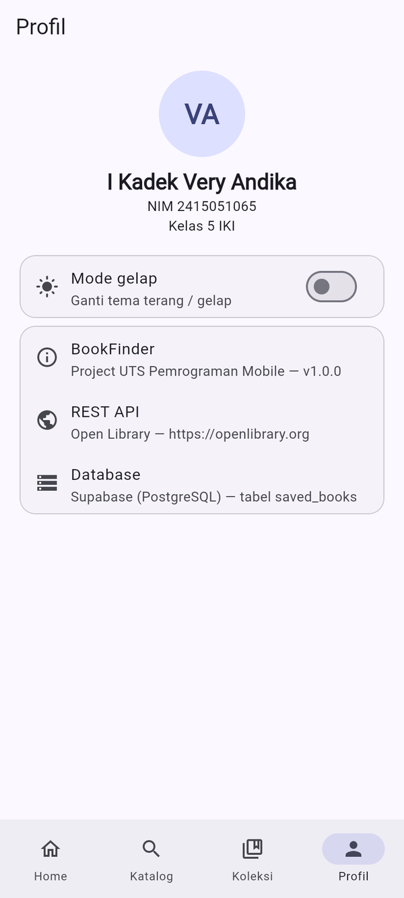 |  | 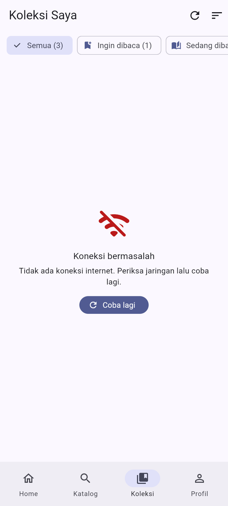 |

**Layout lebar (NavigationRail):**

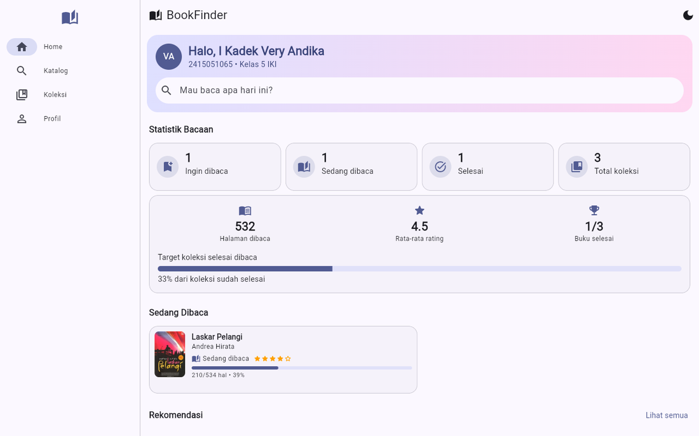
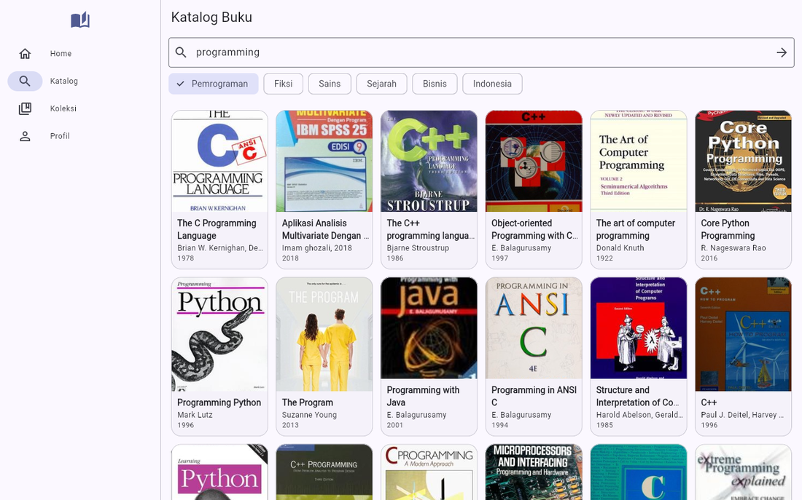
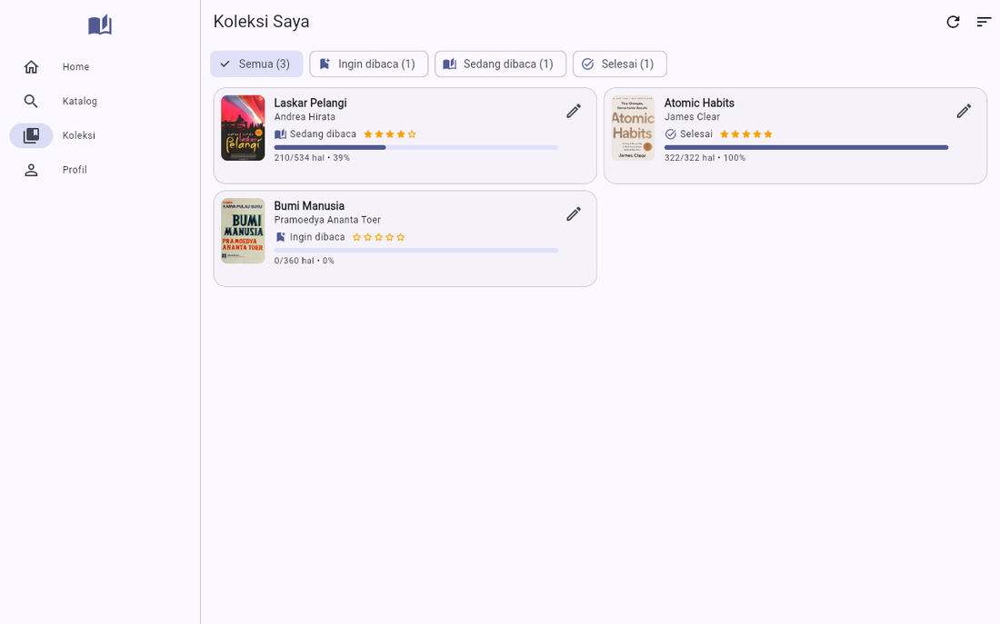

**Data di Supabase:**

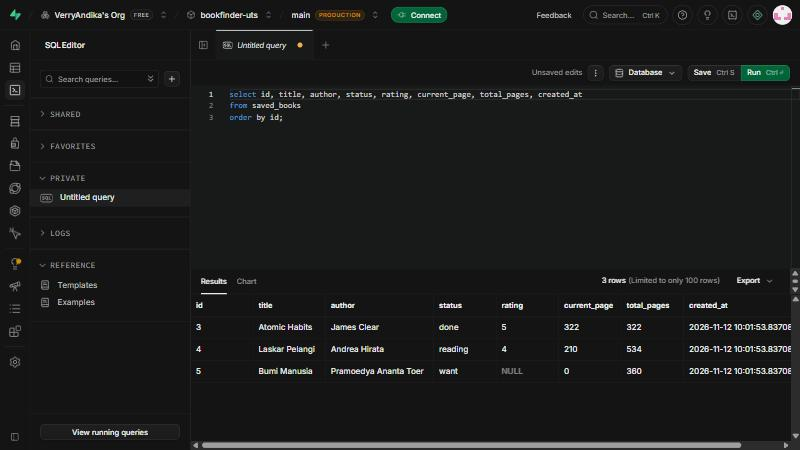

Semua screenshot ada di [`docs/screenshots`](docs/screenshots).

## Cara menjalankan

```bash
git clone https://github.com/VerryAndika/UTS_2415051065_I_Kadek_Very_Andika.git
cd UTS_2415051065_I_Kadek_Very_Andika
flutter pub get
flutter run                 # emulator / HP Android
flutter run -d chrome       # atau di browser
flutter test                # unit & widget test
flutter build apk --release # build APK
```

Aplikasi langsung terhubung ke project Supabase di atas. Untuk memakai project Supabase sendiri:
jalankan `docs/supabase_schema.sql` di SQL Editor, lalu ganti `url` dan `publishableKey`
di `lib/config/supabase_config.dart`.

**APK**: lihat halaman [Releases](https://github.com/VerryAndika/UTS_2415051065_I_Kadek_Very_Andika/releases)
(`UTS_2415051065_I_Kadek_Very_Andika.apk`).

## Riwayat pengembangan (milestone Git)

| # | Milestone | Commit |
|---|---|---|
| 1 | Project Initialization | Initialize Flutter UTS project |
| 2 | Architecture | Setup project architecture and folders |
| 3 | Basic UI | Build initial application UI |
| 4 | Responsive Layout | Implement responsive layouts |
| 5 | Navigation | Add application navigation |
| 6 | Models | Add application data models |
| 7 | State Management | Implement application state management |
| 8 | REST API | Integrate REST API |
| 9 | Database | Integrate backend database |
| 10 | Create | Implement create data feature |
| 11 | Update | Implement update data feature |
| 12 | Delete | Implement delete data feature |
| 13 | Interaction | Add interaction and user feedback |
| 14 | Error Handling | Add loading and error handling |
| 15 | UI Refinement | Improve UI and responsive behavior |
| 16 | Final | Finalize UTS mobile application |

Lihat `git log --oneline` untuk riwayat lengkap.

## Keamanan

- Aplikasi hanya memakai **publishable key** Supabase (memang untuk client, dibatasi RLS).
- **Tidak ada** `service_role`/secret key, password database, token, atau keystore di repository.
- `.env`, `*.jks`, `*.keystore`, `key.properties` diabaikan lewat `.gitignore`.
- Validasi form hanya membantu pengguna; aturan data tetap ditegakkan database
  (`UNIQUE`, `CHECK`, RLS).
